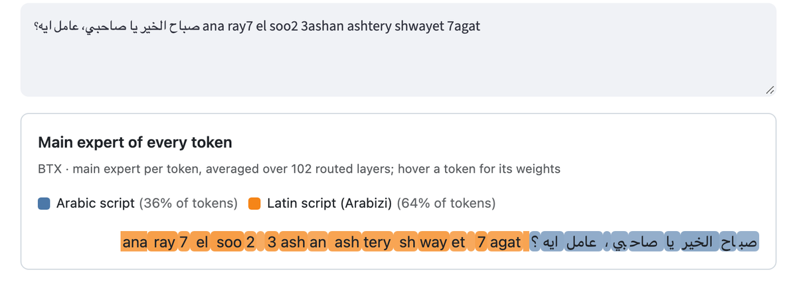

# MoE routing visualizer

See **which experts every token is sent to** in a model built with MixtureKit, layer by
layer: whether the experts specialize (e.g. one per language or script), and whether a
router has collapsed onto one expert.



## The app

```bash
pip install -e ".[vis]"
mixturekit visualize models_merge/gemmax          # a local merged model
mixturekit visualize MBZUAI-Paris/Nile-Chat-3x4B-A6B   # or a Hub id
```

It runs on CUDA, Apple silicon (MPS) or CPU (`--device` to choose) and shows:

| Section | What it tells you |
| --- | --- |
| **Main expert of every token** | Each token coloured by its main expert, averaged over the layers; hover a token for its weights |
| **Expert weights per token** | The weight of every expert for every token, in % |
| **Load of every expert per layer** | The mean weight of each expert in each layer: a layer where one expert takes everything has collapsed routing |

Pick layers in the sidebar to see their routing alone.

## Without the app: an HTML view

```bash
mixturekit visualize models_merge/gemmax --text "Bonjour ! صباح الخير" --html routing.html
```

prints the share of the tokens of every expert and writes a self-contained page you can share.

## In Python or a notebook

```python
from MixtureKit.routing import load_model, trace_routing

model, tokenizer = load_model("models_merge/gemmax")
trace = trace_routing(model, tokenizer, "Bonjour ! صباح الخير")
trace                      # displayed inline in Jupyter and Colab
trace.dominant_experts()   # the main expert of every token
trace.expert_share()       # the share of the tokens of every expert
trace.layer_load()         # (layers, experts) mean weights
trace.layers               # layer -> (tokens, experts) weights
```

## What is shown for each method

* **BTX:** every routed projection has its own router (e.g. `layer 3 · mlp.up_proj`).
* **Traditional MoE:** one router per layer (`layer 3 · mlp`).
* **BTS:** there is no router; the weights are the share of every stream (the hub and the
  experts) in the hub, at the stitch layers that merge the experts into the hub: the size of
  each stream's gated contribution relative to the others.

Routers are created when a model is built and trained afterwards: an untrained model shows
random routing, different at every load.
